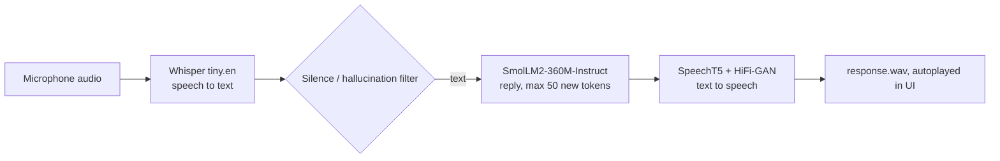

# Edge Voice Assistant

A CPU-only, speech-in / speech-out assistant: record a question, get a spoken reply. Three small open models run in sequence inside one Gradio app, with no external LLM or TTS API calls.

**Live demo:** https://mohit0708-edge-voice-assistant.hf.space/

## Pipeline



## Models (exactly what `app.py` loads)

| Stage | Model | Library | Notes |
|---|---|---|---|
| Speech to text | `openai/whisper-tiny.en` | `transformers` pipeline | English only |
| Language model | `HuggingFaceTB/SmolLM2-360M-Instruct` | `transformers` pipeline | `float32`, `max_new_tokens=50`, `temperature=0.6`, sampling on |
| Text to speech | `microsoft/speecht5_tts` + `microsoft/speecht5_hifigan` | `transformers` | Speaker x-vector: `regisss/cmu-arctic-xvectors`, index 7306 |

All models run on `device="cpu"` (hard-coded). No GPU is required. Weights download from the Hugging Face Hub on first launch.

## Run locally

```bash
git clone https://github.com/Mohitsai3579/Edge-Voice-Assistant.git
cd Edge-Voice-Assistant
python -m venv .venv && source .venv/bin/activate   # Windows: .venv\Scripts\activate
pip install -r requirements.txt
python app.py
```

`packages.txt` lists system packages for Hugging Face Spaces; on your own machine install any audio libraries your OS needs (for example `ffmpeg`).

Docker:

```bash
docker build -t edge-voice-assistant .
docker run -p 7860:7860 edge-voice-assistant
```

Confirm the exposed port against the `Dockerfile` before relying on the command above.

## Hardware requirements

- CPU only; no CUDA needed.
- First run needs internet access and disk space for model downloads.
- RAM and latency depend on your CPU. Measure them with the benchmark below rather than trusting a single number.

## Benchmarks (reproducible)

```bash
pip install psutil
python benchmark.py path/to/sample.wav --runs 10
```

The script prints median and p95 latency per stage (STT, LLM, TTS) and peak process memory. Paste your results here with the CPU model and Python/torch versions:

| Machine | Whisper tiny.en | SmolLM2-360M (50 tok) | SpeechT5 | Peak RSS |
|---|---|---|---|---|
| _fill in after running_ | | | | |

No speed-up claim (for example from ONNX or quantization) is made for this repository. The current code runs the standard PyTorch weights.

## Known limitations

- Single-turn: each recording is answered independently; there is no conversation memory.
- Stages run sequentially (no streaming), so total latency is the sum of all three.
- A 360M-parameter model with a 50-token cap gives short, sometimes inaccurate answers.
- English only (Whisper `tiny.en`), one fixed synthetic voice.
- A simple phrase filter handles Whisper's silence hallucinations; it is not a real voice-activity detector.
- Output is written to a fixed `response.wav`, so concurrent users can overwrite each other's audio.
- `demo.launch(share=True)` creates a public Gradio link when run locally. Remove it if you do not want that.

## Roadmap

- [ ] Benchmark results table (above)
- [ ] Optional ONNX / quantized export, with before-and-after numbers
- [ ] Per-request temp files
- [ ] Conversation history
- [ ] Screenshot or GIF of the UI

## License

MIT
